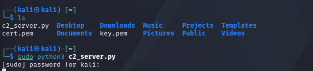
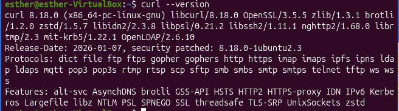
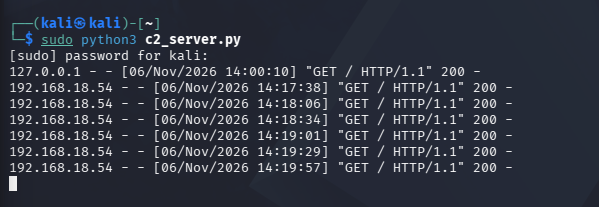
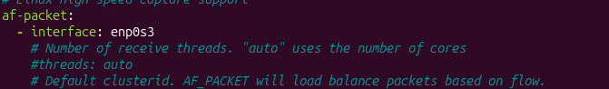
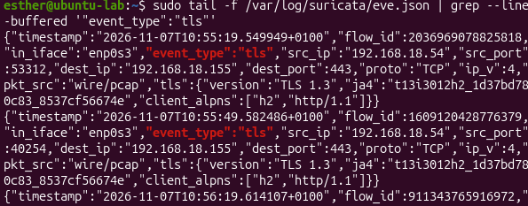
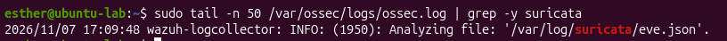
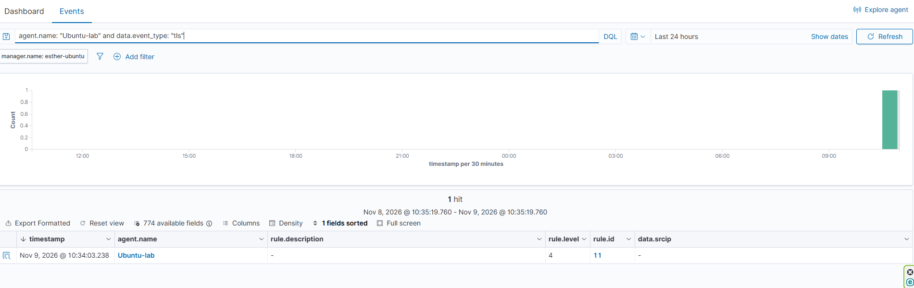
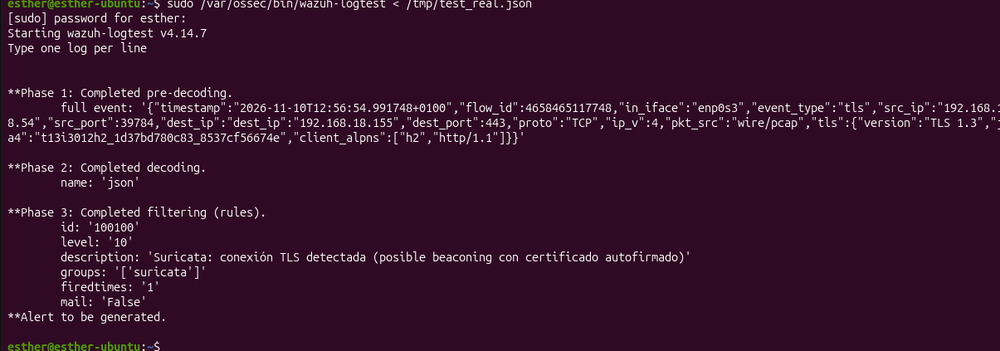

[🇪🇸 Español](README_es.md)

# TLS Beaconing Detection: Self-Signed Certificate C2 Simulation with Suricata and Wazuh

Lab exercise simulating the network traffic pattern of an already-compromised host "calling home" to its command-and-control (C2) server over HTTPS, using a self-signed TLS certificate, and verifying that Suricata and Wazuh can detect and flag it as suspicious. Documented as an L1 SOC analyst case, including a known limitation that was investigated and worked around rather than hidden.

No real intrusion or takeover is simulated, only the network communication pattern that an already-compromised host would generate.

---

## MITRE ATT&CK Mapping

- **Tactics:** Command and Control.
- **Techniques:**
  - [T1573] Encrypted Channel (C2 traffic hidden inside a TLS-encrypted connection)
  - [T1071.001] Application Layer Protocol: Web Protocols (C2 communication disguised as ordinary HTTPS traffic)

---

## 1. Key Concepts

A few concepts are explained here in detail, each followed by **why it matters for this specific lab**: not as abstract definitions, but tied to what we actually built and observed.

**What is C2 "beaconing"?**
Malware that has already infected a host typically doesn't wait for an attacker to connect to it: instead, it periodically "calls home" to a server controlled by the attacker (the C2 server), checking in and waiting for instructions. This periodic, regular-interval traffic pattern is called beaconing.

*Why it matters here:* `beacon.sh` on the victim machine (`Ubuntu-lab`) simulates exactly this: a loop calling out to the C2 server (Kali) every ~30 seconds. The direction of the connection (victim → attacker, never the reverse) is itself a detail worth understanding: a real attacker doesn't connect *into* the victim, they wait for the victim to connect *out*.

**What is a self-signed certificate, and why is it "fake"?**
A normal TLS certificate is signed by a trusted Certificate Authority (CA), a third party that vouches "yes, this server really is who it claims to be." A self-signed certificate is one where the server signs its own certificate: it vouches for itself. Technically this still enables encryption, but it provides no real identity verification.

*Why it matters here:* The `issuer` and `subject` fields of a self-signed certificate are identical: the same decorative domain (`telemetria-segura.com`, never registered anywhere) appears as both who is "asking" and who is "certifying." This is a classic anomaly signal: legitimate public services almost never use self-signed certificates, so seeing one is itself a red flag. It is **not** used here to evade detection, quite the opposite, it's one of the very things that makes this traffic suspicious.

**Why does an attacker use HTTPS (even with a fake cert) instead of plain HTTP?**
TLS encryption hides the *content* of the communication from casual inspection, but it does **not** hide the *fact* that a connection is happening, nor metadata like IP addresses, ports, timing, or certificate details. The goal of using HTTPS isn't to avoid detection systems; it's to blend in superficially with the overwhelming volume of legitimate HTTPS traffic on any network, rather than standing out as one of the few plaintext HTTP connections.

**What is JA3/JA4, and why does it matter more than the certificate itself?**
JA3/JA4 are fingerprints calculated from *how* a TLS handshake is negotiated (which cipher suites, extensions, and settings the client and server offer, and in what order), rather than from the certificate's content. JA4 is the modern successor to JA3.

*Why it matters here:* In **TLS 1.3** (the version used by this lab's server), the certificate itself is sent **encrypted** inside the handshake. A passive network sensor like Suricata, which isn't a party to the connection and has no decryption keys, genuinely **cannot** see the certificate's `subject`/`issuer` fields: this is a real limitation of TLS 1.3, not a misconfiguration. This is exactly why JA3/JA4 exist: they're visible even when the certificate itself is hidden, making them the modern, realistic way to flag this kind of suspicious TLS traffic, which is precisely the detection method this lab actually relies on.

---

## 2. Architecture

| Role | Machine | IP |
|---|---|---|
| C2 server (waits for check-ins) | Kali Linux | `192.168.18.155` |
| "Infected" victim (does the beaconing) + Suricata sensor | Ubuntu-lab | `192.168.18.54` |
| SIEM | Wazuh manager (`wazuh-manager`) | `192.168.18.113` |

The direction of communication is: **`Ubuntu-lab` calls Kali**, never the other way around (Kali only listens, passively).

---

## 3. Setting Up the C2 Server (Kali)

Generate a self-signed certificate with OpenSSL:

```bash
openssl req -x509 -newkey rsa:2048 -keyout key.pem -out cert.pem -days 365 -nodes -subj "/CN=telemetria-segura.com"
```

- `key.pem`: the server's private key (never shared).
- `cert.pem`: the certificate, which embeds the matching public key and the decorative Common Name `telemetria-segura.com`. This "domain" is purely text inside the certificate, it isn't registered in any public DNS and isn't reachable from outside the lab; the beaconing script calls the IP directly, never the domain name.

Minimal HTTPS server in Python, listening on port 443 (realistic, versus an alternate port like 8443, at the cost of needing `sudo` since it's a privileged port):

```python
import http.server, ssl

server_address = ('0.0.0.0', 443)
httpd = http.server.HTTPServer(server_address, http.server.SimpleHTTPRequestHandler)

context = ssl.SSLContext(ssl.PROTOCOL_TLS_SERVER)
context.load_cert_chain(certfile="cert.pem", keyfile="key.pem")
httpd.socket = context.wrap_socket(httpd.socket, server_side=True)

httpd.serve_forever()
```

```bash
sudo python3 c2_server.py
```

The server starts and stays listening indefinitely thanks to `serve_forever()`: a hung terminal here is a good sign, not a bug.

Before touching the victim machine, the server itself was sanity-checked from a second terminal on Kali:

```bash
curl -k https://localhost
```



This sends an HTTPS request to the server and deliberately skips certificate validation: `-k` / `--insecure` tells `curl` not to reject the connection even though the certificate is self-signed and not issued by a trusted CA.

---

## 4. Beaconing Script (Ubuntu-lab)

With the server confirmed, it was time to move to the victim machine (registered in Wazuh as `Ubuntu-lab`), which generates the beaconing traffic (the repeated calls to the C2 already running on Kali). A simple bash script does the job, deliberately kept simpler than Python for this:

```bash
#!/bin/bash
while true; do
    curl -k -s -o /dev/null https://192.168.18.155
    sleep 30
done
```



```bash
chmod +x beacon.sh
./beacon.sh
```

`curl -k` connects over HTTPS while skipping certificate validation (necessary here only because the certificate is self-signed and not from a trusted CA); a real browser would normally show a warning instead. After `chmod +x`, running the script hangs the terminal again: this time it means the loop is alive and calling Kali every 30 seconds, with no human triggering each request.



*Kali's access log showing periodic connections from `192.168.18.54` at roughly 30-second intervals.* This single screenshot already tells half the story of the lab: `Ubuntu-lab` calling Kali on its own, automatically, at a fixed interval: exactly the beaconing pattern a SOC analyst learns to recognize.

---

## 5. Suricata Detection

Suricata was installed on `Ubuntu-lab` and configured to listen on the `enp0s3` interface (the one carrying the victim's traffic, IP `192.168.18.54`):

```yaml
af-packet:
  - interface: enp0s3
```



`af-packet` is the method Suricata uses on Linux to capture packets directly from a network interface in real time: this line tells it "watch the traffic going through `enp0s3`."

With the beaconing running, Suricata's `eve.json` log captures each connection as a `tls`-type event, including the JA4 fingerprint:

```bash
sudo tail -f /var/log/suricata/eve.json | grep --line-buffered '"event_type":"tls"'
```

```json
{"timestamp":"2026-11-07T10:55:19.549949+0100","event_type":"tls","src_ip":"192.168.18.54","dest_ip":"192.168.18.155","dest_port":443,"tls":{"version":"TLS 1.3","ja4":"t13i3012h2_1d37bd780c83_8537cf56674e","client_alpns":["h2","http/1.1"]}}
```



**Note:** `extended: yes` is already enabled by default under the TLS section of Suricata's `eve-log` output, which would normally also log the certificate's `subject`/`issuer` fields: this is the setting that matters most for the lab, since in theory it's the signal that would directly prove the certificate is self-signed. As explained in the Key Concepts section above, these fields never appear here because TLS 1.3 encrypts the certificate inside the handshake, a real limitation, not a misconfiguration. Detection in this lab relies on the JA4 fingerprint and the connection pattern instead.

---

## 6. Detection in Wazuh

### Pipeline: Suricata → Wazuh agent → manager

The Wazuh agent on `Ubuntu-lab` was configured to read Suricata's log directly, by adding a `<localfile>` block to `/var/ossec/etc/ossec.conf`:

```xml
<ossec_config>
  <localfile>
    <log_format>json</log_format>
    <location>/var/log/suricata/eve.json</location>
  </localfile>
</ossec_config>
```

After restarting the agent and confirming it was `active`, the pickup was verified directly in the agent's own internal log:

```bash
sudo tail -n 50 /var/ossec/logs/ossec.log | grep -i suricata
```



```
2026/11/07 17:09:48 wazuh-logcollector: INFO: (1950): Analyzing file: '/var/log/suricata/eve.json'.
```

Breaking that line down: `wazuh-logcollector` is the agent component that reads log files and forwards them to the manager; `INFO (1950)` is an informational message (not an error), the event's internal code; and `Analyzing file: eve.json` confirms the agent picked up the new configuration and is now actively watching that file. This was confirmed working end-to-end: the events reach the manager correctly decoded (confirmed via the manager's archive log, with full `data.event_type`, `data.src_ip`, `data.tls.*` fields populated).

### Volume-based detection (working, confirmed live)

Wazuh's built-in statistical rule (`rule.id: 11`), which flags an abnormal spike in the number of logs received per hour, fired reliably against the real beaconing traffic:



*"The average number of logs between 12:00 and 13:00 is X. We reached Y.": a legitimate anomaly-based detection, where the beaconing's steady traffic volume is itself a signal, independent of inspecting any single event's content. Many real EDR/SIEM products use exactly this kind of volume/periodicity-based detection for C2 beaconing, in addition to or instead of content-based signatures.*

### Custom content-based rule (written and validated, with a known limitation)

A custom rule was written in the manager's `/var/ossec/etc/rules/local_rules.xml`, to classify these TLS events with a higher severity and a specific description, instead of only the generic volume alert:

```xml
<group name="suricata,">
  <rule id="100100" level="10">
    <decoded_as>json</decoded_as>
    <match>"event_type":"tls"</match>
    <description>Suricata: TLS connection detected (possible beaconing with self-signed certificate)</description>
  </rule>
</group>
```

This rule was validated using `wazuh-logtest` (the standard Wazuh tool for testing detection rules against a sample log before deploying them) and it correctly fires:



```
**Phase 3: Completed filtering (rules).
        id: '100100'
        level: '10'
        description: 'Suricata: TLS connection detected (possible beaconing with self-signed certificate)'
**Alert to be generated.
```

**Known limitation:** despite firing correctly against test input via `wazuh-logtest`, this same rule did **not** fire against the live beaconing traffic in production, even after confirming (via the manager's full archive log) that the exact same events reach the manager, fully decoded, with identical content. The root cause wasn't identified: it may be a difference in how `wazuh-logtest`'s evaluation engine behaves compared to the live `analysisd` process under continuous traffic. This is documented here as an open finding rather than omitted, since the volume-based detection above already provides a working, real detection path for this scenario.

---

## 7. Incident Summary

| Field | Detail |
|---|---|
| Detected pattern | Periodic HTTPS beaconing to a fixed external IP, over a self-signed TLS certificate |
| Primary detection | Wazuh `rule.id: 11`, abnormal log volume per hour, driven by the beaconing traffic |
| Supporting evidence | Suricata JA4 fingerprint per connection; self-signed certificate (`subject == issuer`, not directly visible due to TLS 1.3 encryption, but structurally implied) |
| Secondary detection (validated, not yet live) | Custom rule `100100`, content-based, validated via `wazuh-logtest` |
| Source IP | 192.168.18.54 (`Ubuntu-lab`) |
| Destination IP | 192.168.18.155 (Kali, acting as C2) |

---

## 8. Conclusion

This lab demonstrates that a C2 beaconing pattern over an encrypted, self-signed-certificate HTTPS channel is detectable even when the certificate's own fields are hidden by TLS 1.3 encryption, through connection metadata (JA4 fingerprinting) and traffic volume/periodicity, rather than packet content inspection. It also illustrates a realistic SOC workflow: a planned detection approach (a custom content-matching rule) didn't behave as expected once deployed, the discrepancy was investigated and documented rather than hidden, and a working alternative detection path was confirmed and used instead.

---

## 9. Next Steps

- Investigate the discrepancy between `wazuh-logtest` validation and live rule evaluation for rule `100100`.
- Extend the custom rule to also flag the specific combination of self-signed certificate + high-frequency periodic connections, once the live-firing issue is resolved.
- Build the next lab in the portfolio series (FIM + VirusTotal integration), continuing the same Wazuh environment.
