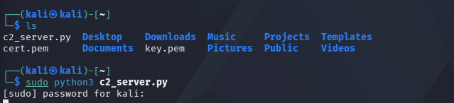
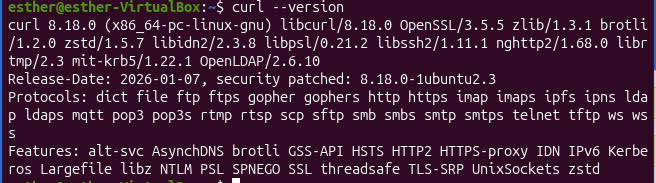
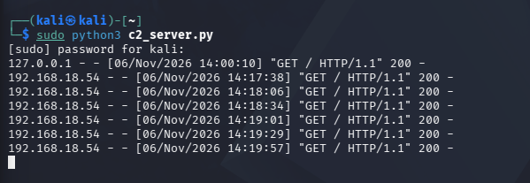
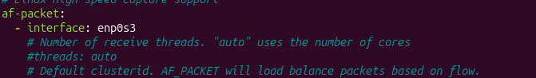
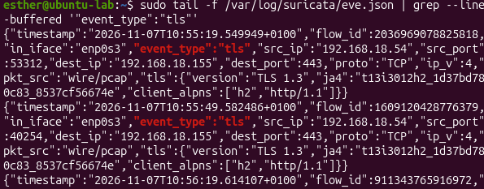
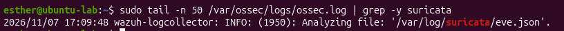
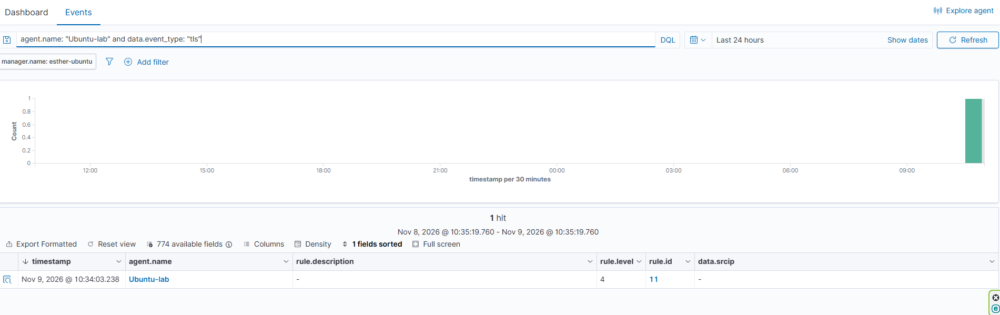
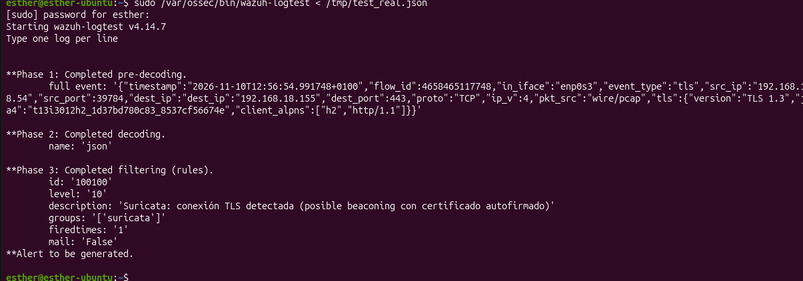

[🇬🇧 English](README.md)

# Detección de beaconing TLS: Simulación de C2 con certificado autofirmado usando Suricata y Wazuh

Práctica de laboratorio que simula el patrón de tráfico de red de un equipo ya comprometido "llamando a casa" a su servidor de mando y control (C2) mediante HTTPS, usando un certificado TLS autofirmado, y comprueba que Suricata y Wazuh son capaces de detectarlo y marcarlo como sospechoso. Documentado como un caso de triaje de analista SOC L1, incluyendo una limitación conocida que se investigó y se sorteó en vez de ocultarse.

No se simula una intrusión ni toma de control real, solo el patrón de comunicación de red que generaría un host ya comprometido.

---

## Mapeo MITRE ATT&CK

- **Tácticas:** Command and Control.
- **Técnicas:**
  - [T1573] Encrypted Channel (tráfico C2 oculto dentro de una conexión cifrada con TLS)
  - [T1071.001] Application Layer Protocol: Web Protocols (comunicación C2 disfrazada de tráfico HTTPS normal)

---

## 1. Conceptos clave

Aquí se explican con detalle varios conceptos, cada uno seguido de **por qué te importa esto para este lab en concreto**: no como definiciones de libro de texto, sino conectados con lo que realmente construimos y observamos.

**¿Qué es el "beaconing" de C2?**
Un malware que ya ha infectado un equipo normalmente no espera a que el atacante se conecte a él: en vez de eso, "llama a casa" periódicamente a un servidor controlado por el atacante (el servidor C2), comprobando si hay instrucciones pendientes. Este patrón de tráfico periódico, a intervalos regulares, se llama beaconing.

*¿Por qué te importa esto aquí?* `beacon.sh`, en la máquina víctima (`Ubuntu-lab`), simula exactamente esto: un bucle que llama al servidor C2 (Kali) cada ~30 segundos. La dirección de la conexión (víctima → atacante, nunca al revés) es un detalle que merece la pena entender bien: un atacante real no se conecta *hacia dentro* de la víctima, espera a que la víctima se conecte *hacia fuera*.

**¿Qué es un certificado autofirmado, y por qué es "falso"?**
Un certificado TLS normal lo firma una Autoridad Certificadora (CA) de confianza, un tercero que garantiza "sí, este servidor es realmente quien dice ser". Un certificado autofirmado es uno en el que el propio servidor firma su propio certificado: se avala a sí mismo. Técnicamente esto sigue permitiendo cifrar la comunicación, pero no aporta ninguna verificación real de identidad.

*¿Por qué te importa esto aquí?* Los campos `issuer` (emisor) y `subject` (titular) de un certificado autofirmado son idénticos: el mismo dominio decorativo (`telemetria-segura.com`, nunca registrado en ningún sitio) aparece tanto como quien "pide" el certificado como quien lo "certifica". Esta es una señal de anomalía clásica: los servicios públicos legítimos casi nunca usan certificados autofirmados, así que ver uno ya es, de por sí, una bandera roja. **No** se usa aquí para evadir la detección, al contrario, es precisamente una de las cosas que hace que este tráfico sea sospechoso.

**¿Por qué usa un atacante HTTPS (aunque sea con un certificado falso) en vez de HTTP sin cifrar?**
El cifrado TLS oculta el *contenido* de la comunicación frente a una inspección superficial, pero **no** oculta el *hecho* de que hay una conexión, ni metadatos como IPs, puertos, momentos de conexión o detalles del certificado. El objetivo de usar HTTPS no es evitar los sistemas de detección; es pasar desapercibido mezclándose con el volumen abrumador de tráfico HTTPS legítimo que hay en cualquier red, en vez de destacar como una de las pocas conexiones HTTP en texto plano.

**¿Qué es JA3/JA4, y por qué importa más que el propio certificado?**
JA3/JA4 son huellas digitales calculadas a partir de *cómo* se negocia un handshake TLS (qué conjuntos de cifrado, extensiones y ajustes ofrecen el cliente y el servidor, y en qué orden), en vez de a partir del contenido del certificado. JA4 es el sucesor moderno de JA3.

*¿Por qué te importa esto aquí?* En **TLS 1.3** (la versión que usa el servidor de este laboratorio), el propio certificado se envía **cifrado** dentro del handshake. Un sensor de red pasivo como Suricata, que no participa en la conexión y no tiene las claves de descifrado, **no puede** ver realmente los campos `subject`/`issuer` del certificado: esto es una limitación real de TLS 1.3, no un error de configuración. Por eso existen precisamente JA3/JA4: son visibles aunque el propio certificado esté oculto, convirtiéndose en la forma moderna y realista de señalar este tipo de tráfico TLS sospechoso, que es exactamente el método de detección en el que se apoya este laboratorio.

---

## 2. Arquitectura

| Rol | Máquina | IP |
|---|---|---|
| Servidor C2 (espera las llamadas) | Kali Linux | `192.168.18.155` |
| Víctima "infectada" (hace el beaconing) + sensor Suricata | Ubuntu-lab | `192.168.18.54` |
| SIEM | Wazuh manager (`wazuh-manager`) | `192.168.18.113` |

La dirección de la comunicación es: **`Ubuntu-lab` llama a Kali**, nunca al revés (Kali solo escucha, de forma pasiva).

---

## 3. Preparación del servidor C2 (Kali)

Generar un certificado autofirmado con OpenSSL:

```bash
openssl req -x509 -newkey rsa:2048 -keyout key.pem -out cert.pem -days 365 -nodes -subj "/CN=telemetria-segura.com"
```

- `key.pem`: la clave privada del servidor (nunca se comparte).
- `cert.pem`: el certificado, que incorpora la clave pública correspondiente y el Common Name decorativo `telemetria-segura.com`. Este "dominio" es solo texto dentro del certificado, no está registrado en ningún DNS público ni es alcanzable desde fuera del laboratorio; el script de beaconing llama directamente a la IP, nunca al nombre de dominio.

Servidor HTTPS mínimo en Python, escuchando en el puerto 443 (más realista que un puerto alternativo como el 8443, a cambio de necesitar `sudo`, al ser un puerto privilegiado):

```python
import http.server, ssl

server_address = ('0.0.0.0', 443)
httpd = http.server.HTTPServer(server_address, http.server.SimpleHTTPRequestHandler)

context = ssl.SSLContext(ssl.PROTOCOL_TLS_SERVER)
context.load_cert_chain(certfile="cert.pem", keyfile="key.pem")
httpd.socket = context.wrap_socket(httpd.socket, server_side=True)

httpd.serve_forever()
```

```bash
sudo python3 c2_server.py
```

El servidor arranca y se queda escuchando conexiones indefinidamente gracias a `serve_forever()`: ver la terminal "colgada" aquí es buena señal, no un fallo.

Antes de tocar la máquina víctima, se comprobó el propio servidor desde una segunda terminal en Kali:

```bash
curl -k https://localhost
```



Esto hace una petición HTTPS a mi propio servidor saltándose la validación del certificado, porque el flag `-k` (`--insecure`) le dice a `curl` que no rechace la conexión aunque el certificado sea autofirmado y no esté firmado por una entidad de confianza.

---

## 4. Script de beaconing (Ubuntu-lab)

Con el servidor confirmado, tocaba pasar a la máquina víctima (registrada en Wazuh como `Ubuntu-lab`), que es la que genera el tráfico de beaconing (la que llama repetidamente al C2 que ya está corriendo en Kali). Para eso basta un script sencillo en bash, más simple que Python para esto:

```bash
#!/bin/bash
while true; do
    curl -k -s -o /dev/null https://192.168.18.155
    sleep 30
done
```



```bash
chmod +x beacon.sh
./beacon.sh
```

`curl -k` se conecta por HTTPS omitiendo la validación del certificado (necesario aquí solo porque el certificado es autofirmado y no proviene de una CA de confianza); un navegador real mostraría normalmente un aviso en su lugar. Tras darle permisos de ejecución, al lanzarlo la terminal se queda colgada de nuevo, y eso significa que el bucle está corriendo y llamando a Kali cada 30 segundos.



*Log de acceso de Kali mostrando conexiones periódicas desde `192.168.18.54`, a intervalos de unos 30 segundos.* Esto es literalmente el patrón de beaconing funcionando: `Ubuntu-lab` llamando a Kali de forma regular y automática, sin intervención humana. Esta captura por sí sola ya cuenta la mitad de la historia del laboratorio.

---

## 5. Detección con Suricata

Suricata se instaló en `Ubuntu-lab` y se configuró para escuchar en la interfaz `enp0s3` (la que lleva el tráfico de la víctima, IP `192.168.18.54`):

```yaml
af-packet:
  - interface: enp0s3
```



`af-packet` es el método que usa Suricata en Linux para capturar paquetes directamente de una interfaz de red en tiempo real: esta línea le dice "mira el tráfico que pasa por `enp0s3`".

Con el beaconing corriendo, el log `eve.json` de Suricata captura cada conexión como un evento de tipo `tls`, incluyendo la huella JA4:

```bash
sudo tail -f /var/log/suricata/eve.json | grep --line-buffered '"event_type":"tls"'
```

```json
{"timestamp":"2026-11-07T10:55:19.549949+0100","event_type":"tls","src_ip":"192.168.18.54","dest_ip":"192.168.18.155","dest_port":443,"tls":{"version":"TLS 1.3","ja4":"t13i3012h2_1d37bd780c83_8537cf56674e","client_alpns":["h2","http/1.1"]}}
```



**Nota:** `extended: yes` ya está activo por defecto en la sección TLS de la salida `eve-log` de Suricata, precisamente el ajuste clave para el laboratorio, ya que en teoría es la señal que demostraría directamente que el certificado es autofirmado. Lo que no aparece es el detalle: como se explica en la sección de Conceptos Clave, estos campos nunca aparecen aquí porque TLS 1.3 cifra el certificado dentro del handshake, una limitación real, no un error de configuración. La detección en este laboratorio se apoya en la huella JA4 y en el patrón de conexión en su lugar.

---

## 6. Detección en Wazuh

### Tubería: Suricata → agente Wazuh → manager

El agente de Wazuh en `Ubuntu-lab` se configuró para leer directamente el log de Suricata, añadiendo un bloque `<localfile>` en `/var/ossec/etc/ossec.conf`:

```xml
<ossec_config>
  <localfile>
    <log_format>json</log_format>
    <location>/var/log/suricata/eve.json</location>
  </localfile>
</ossec_config>
```

Tras reiniciar el agente y comprobar que estaba `active`, se verificó directamente en el log interno del propio agente:

```bash
sudo tail -n 50 /var/ossec/logs/ossec.log | grep -i suricata
```



```
2026/11/07 17:09:48 wazuh-logcollector: INFO: (1950): Analyzing file: '/var/log/suricata/eve.json'.
```

Desglose: `wazuh-logcollector` es el componente del agente que lee archivos de log y los envía al manager; `INFO (1950)` es un mensaje informativo (no un error), el código interno del evento; y `Analyzing file: eve.json` confirma que el agente detectó la nueva configuración y ya está leyendo/vigilando ese archivo. Se confirmó que esto funciona de extremo a extremo: los eventos llegan al manager correctamente decodificados (confirmado a través del log de archivo del manager, con los campos `data.event_type`, `data.src_ip`, `data.tls.*` completos).

### Detección por volumen (funcional, confirmada en vivo)

La regla estadística integrada de Wazuh (`rule.id: 11`), que marca un pico anómalo en el número de logs recibidos por hora, se disparó de forma fiable con el tráfico real de beaconing:



*"El número medio de logs entre las 12:00 y las 13:00 es X. Hemos alcanzado Y.": una detección legítima basada en anomalías, donde el volumen constante de tráfico del beaconing es, por sí mismo, una señal, independiente de inspeccionar el contenido de ningún evento individual. Muchos productos EDR/SIEM reales usan exactamente este tipo de detección por volumen/periodicidad para beaconing de C2, además de (o en vez de) firmas basadas en contenido.*

### Regla personalizada basada en contenido (escrita y validada, con una limitación conocida)

Se escribió una regla personalizada en `/var/ossec/etc/rules/local_rules.xml` del manager, para clasificar estos eventos TLS con mayor severidad y una descripción específica, en vez de solo la alerta genérica de volumen:

```xml
<group name="suricata,">
  <rule id="100100" level="10">
    <decoded_as>json</decoded_as>
    <match>"event_type":"tls"</match>
    <description>Suricata: conexión TLS detectada (posible beaconing con certificado autofirmado)</description>
  </rule>
</group>
```

Esta regla se validó usando `wazuh-logtest` (la herramienta estándar de Wazuh para probar reglas de detección contra un log de ejemplo antes de desplegarlas) y se dispara correctamente:



```
**Phase 3: Completed filtering (rules).
        id: '100100'
        level: '10'
        description: 'Suricata: conexión TLS detectada (posible beaconing con certificado autofirmado)'
**Alert to be generated.
```

**Limitación conocida:** a pesar de dispararse correctamente contra el log de prueba con `wazuh-logtest`, esta misma regla **no** se disparó contra el tráfico real de beaconing en producción, incluso después de confirmar (a través del log de archivo completo del manager) que esos mismos eventos llegan al manager, totalmente decodificados, con el contenido idéntico. No se identificó la causa raíz: podría deberse a una diferencia entre cómo evalúa `wazuh-logtest` y cómo lo hace el proceso `analysisd` en producción, bajo tráfico continuo. Se documenta aquí como un hallazgo abierto en vez de omitirlo, ya que la detección por volumen de arriba ya ofrece una vía de detección real y funcional para este escenario.

---

## 7. Resumen del incidente

| Campo | Detalle |
|---|---|
| Patrón detectado | Beaconing HTTPS periódico hacia una IP externa fija, sobre un certificado TLS autofirmado |
| Detección principal | Wazuh `rule.id: 11`, volumen anómalo de logs por hora, generado por el tráfico de beaconing |
| Evidencia de apoyo | Huella JA4 de Suricata por conexión; certificado autofirmado (`subject == issuer`, no visible directamente por el cifrado de TLS 1.3, pero implícito estructuralmente) |
| Detección secundaria (validada, aún no en vivo) | Regla personalizada `100100`, basada en contenido, validada con `wazuh-logtest` |
| IP origen | 192.168.18.54 (`Ubuntu-lab`) |
| IP destino | 192.168.18.155 (Kali, actuando como C2) |

---

## 8. Conclusión

Este laboratorio demuestra que un patrón de beaconing de C2 sobre un canal HTTPS cifrado con certificado autofirmado es detectable incluso cuando los propios campos del certificado quedan ocultos por el cifrado de TLS 1.3, a través de metadatos de la conexión (huella JA4) y del volumen/periodicidad del tráfico, en vez de la inspección del contenido de los paquetes. También ilustra un flujo de trabajo realista de SOC: un enfoque de detección planeado (una regla personalizada basada en contenido) no se comportó como se esperaba una vez desplegado, la discrepancia se investigó y se documentó en vez de ocultarse, y se confirmó y usó una vía de detección alternativa que sí funciona.

---

## 9. Próximos pasos

- Investigar la discrepancia entre la validación con `wazuh-logtest` y la evaluación en vivo de la regla `100100`.
- Ampliar la regla personalizada para marcar también la combinación específica de certificado autofirmado + conexiones periódicas de alta frecuencia, una vez resuelto el problema de disparo en vivo.
- Construir el siguiente laboratorio de la serie del portfolio (integración de FIM + VirusTotal), continuando con el mismo entorno de Wazuh.
